# RetailLens

Retail business intelligence and analytics platform: import retail
transaction data, validate it, and explore sales, customer, product and
geographic performance. Built to the RetailLens coding-agent specification
v1.0.

**Status: analyst-workspace release complete (M9 plus the analysis follow-up).** Users sign in, work inside
an organisation, upload a transaction CSV, inspect its columns, map them to the
standard transaction model, process the dataset into raw rows, dimensions and
sales/return facts, and analyse sales, customer and product performance. They
can forecast monthly net sales against a seasonal-naive baseline with 95%
bands, inspect anomalies in the observed history, and save sales, customer or
product reports with their metric definitions for CSV or PDF export. See
`docs/` for the design decisions later milestones build on.

## Stack

| Layer | Technology |
| --- | --- |
| Frontend | Angular 22, TypeScript, Tailwind CSS 4 |
| API | Django 5.2, Django REST Framework, drf-spectacular (OpenAPI) |
| Data | PostgreSQL 17 |
| Async work | Celery 5.5 on Redis 7 |
| Analytics | Django ORM metric services (M5–M7); dependency-free Holt/seasonal-naive Python model (M8); Pandas / NumPy / SciPy / scikit-learn / Statsmodels reserved for later modelling |
| Reporting | Saved report definitions, Celery export jobs, ReportLab PDF rendering and UTF-8 CSV (M9) |
| Infrastructure | Docker Compose, GitHub Actions |

## Screenshots

Every image below is the running application captured against the seeded
two-year demo dataset (`seed_synthetic_sales`), signed in as an owner of one
organisation. Nothing is a mockup or a design file.

**Dashboard** — the landing view: the resolved reporting period, the shared
dataset/period/comparison filters, headline KPIs, net sales by day, week or
month, which datasets contributed, and how fresh the warehouse is.

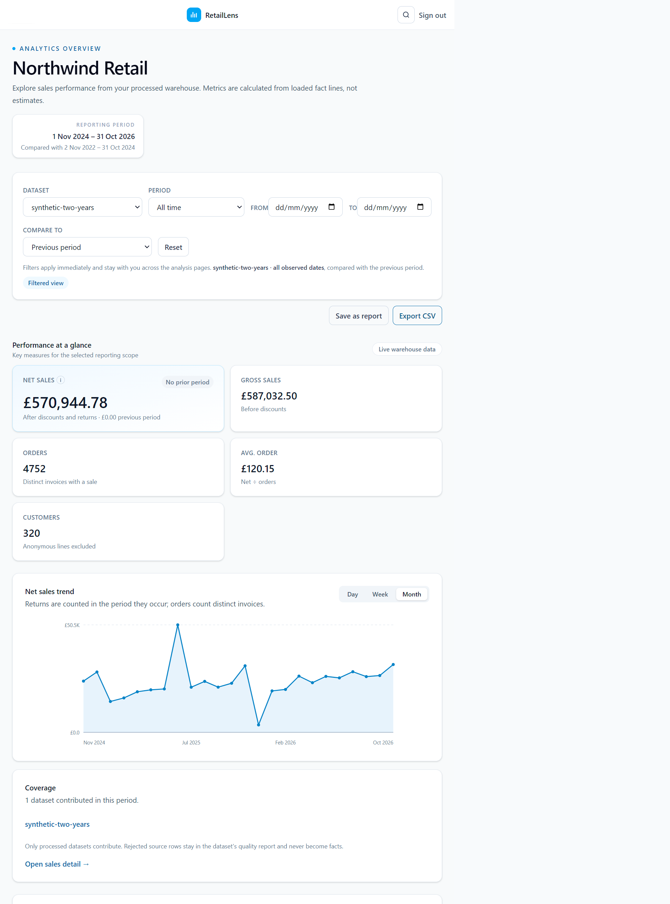

**Sales** — six sales measures for the selected scope, then the same series as
a table with relative bars, so a spike or a lost month is visible at a glance.

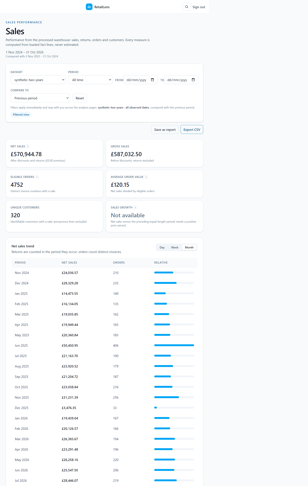

**Products** — revenue concentration: net sales, product count, top-product
share and how many products are declining, above a ranked, searchable and
sortable table of every product in the scope.

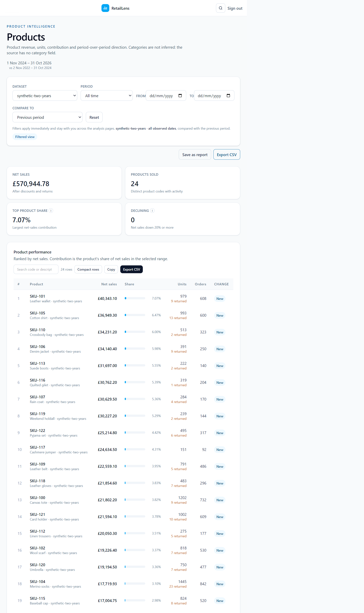

**Customers** — repeat-purchase and retention measures, RFM segment totals, a
monthly cohort retention grid, and a scored customer table with segment filters
and saved segments.

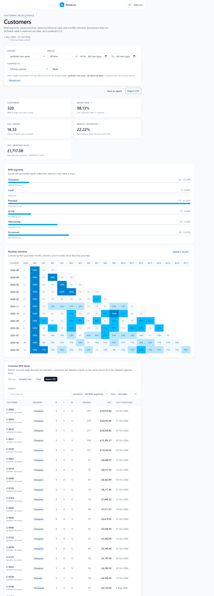

**Geography** — revenue, orders, customers and return rate per country. Lines
without a country are kept as "Unassigned" so the rows always reconcile with
Sales.

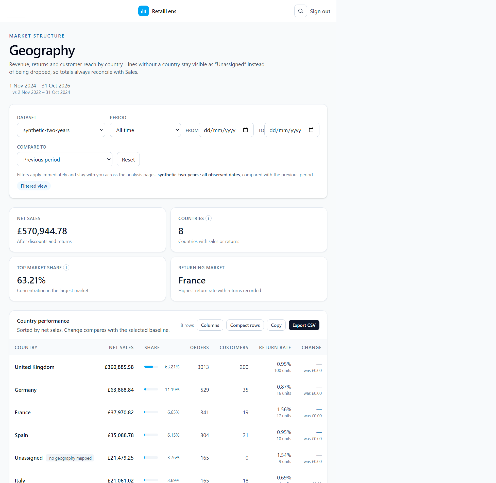

**Returns & discounts** — return and discount rates, the gross-to-net bridge,
the products that give the most back, and returns by country.

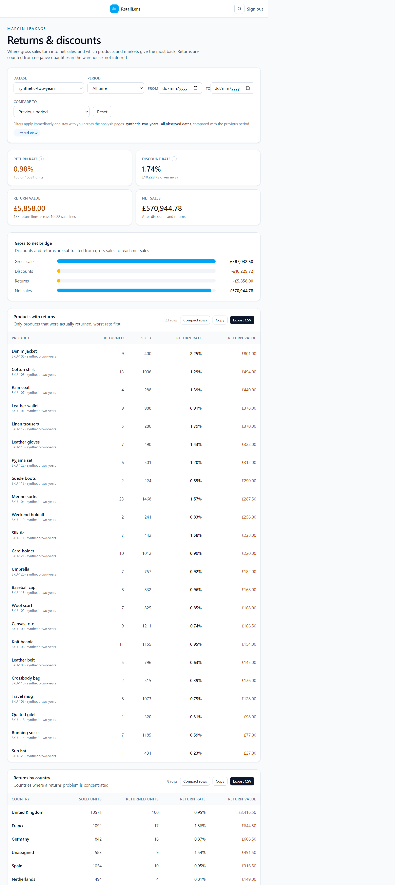

**Market basket** — which products share an invoice, ranked by lift, with
support and both confidence directions next to each pair.

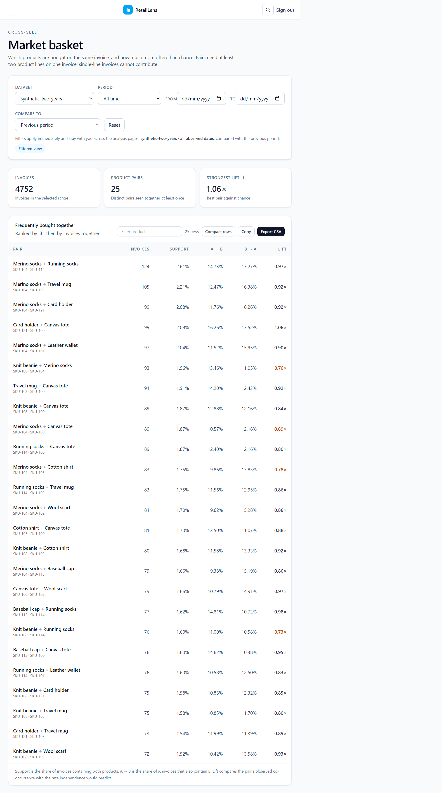

**Datasets** — upload a transaction CSV (the file is preserved as supplied) and
see every dataset with its status, row and column counts and quality summary.

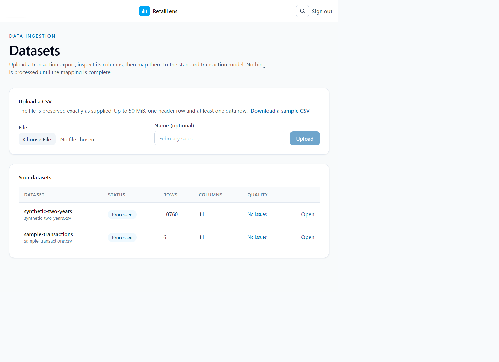

**Dataset detail** — the detected columns with sample values, the mapping of
each source column to a canonical field, the row counts of the latest run, and
Reprocess and Remove actions.

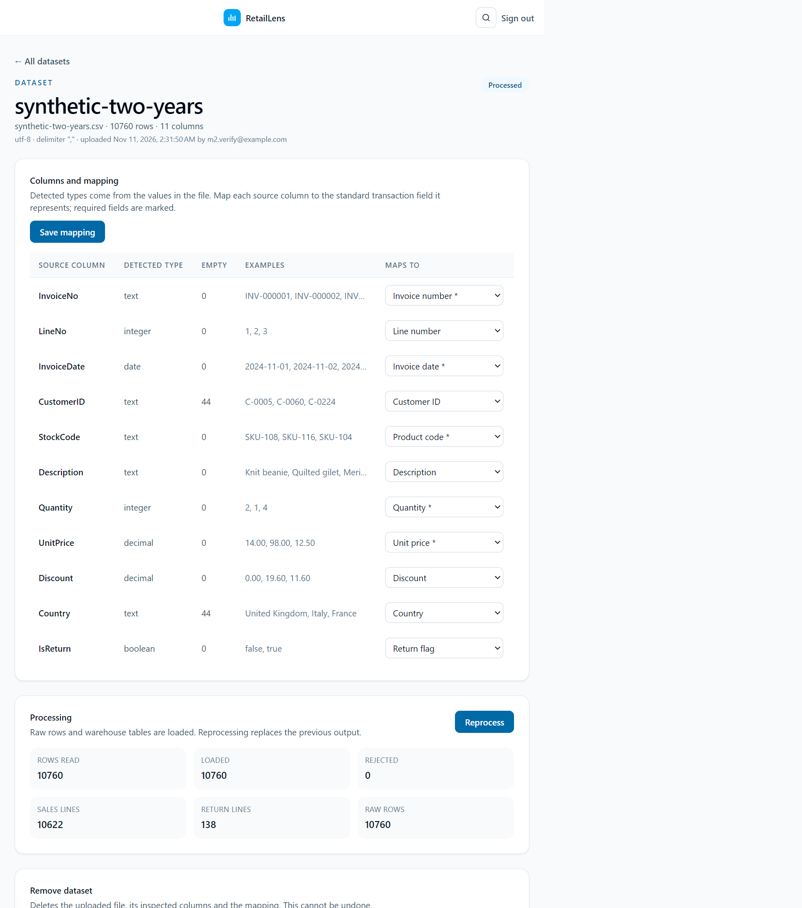

**Data quality** — every rejected row and the reason it failed, across all
datasets in the organisation, worst dataset first, exportable as CSV.

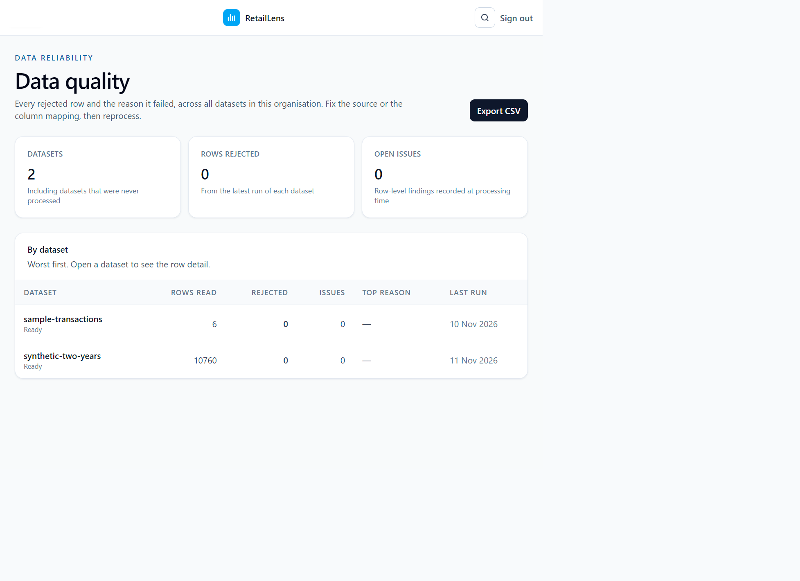

**Forecasting** — a completed run: the train/validate/test split, model error
against the seasonal-naive baseline, the forecast with its 95% interval, the
monthly numbers, and the two seeded anomalies with their triage controls.

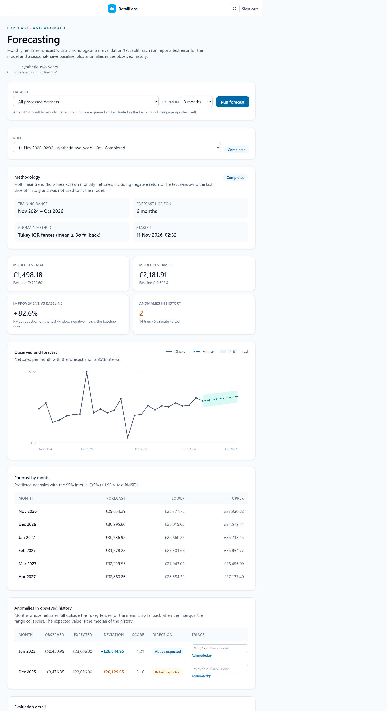

**Monitoring** — threshold alerts that record one event per breach, period
targets with pace, and scheduled report delivery.

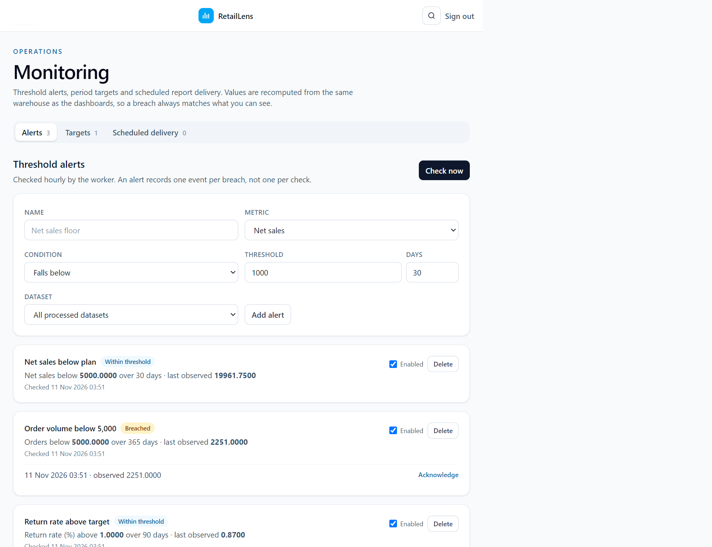

**Boards** — saved layouts of widgets: pick the widgets once, and every number
is refetched with the current filters whenever the board is opened.

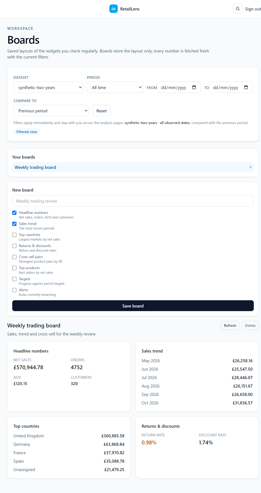

**Reports** — save a report definition, read it computed from the live
warehouse with its metric definitions attached, and generate CSV or PDF exports.

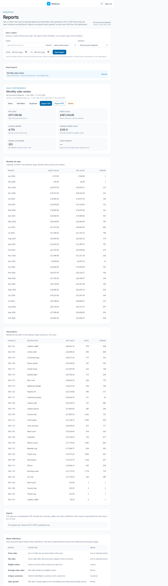

## Pages and what they do

| Page | Route | What it is for | What you can do there |
| --- | --- | --- | --- |
| Sign in | `/login` | Entry point for the workspace | Sign in, or register a new account and workspace in one step |
| Dashboard | `/dashboard` | Orientation: is the data fresh, and how is the business doing | Set dataset, period and comparison and carry them across the analysis pages; read the KPIs; switch the trend between day, week and month; save a report; export CSV; jump to Sales or to the dataset list |
| Datasets | `/datasets` | Get transaction data in | Upload a CSV (50 MiB limit, delimiter detected), download the sample file, open any dataset |
| Dataset detail | `/datasets/:id` | Make raw columns mean something | Review detected types and sample values, map each column to a canonical field, save the mapping, process or reprocess into the warehouse, delete the dataset |
| Sales | `/sales` | Sales performance for the chosen scope | Six KPIs with their definitions, the period table with relative bars, save as report, export CSV |
| Customers | `/customers` | Who buys, how often, and whether they come back | Repeat rate, average orders, observed value, month-1 retention, RFM segment totals, cohort grid, search/sort/page the scored customer list, save and apply segments |
| Customer detail | `/customers/:id` | One customer's behaviour | Value and score, share of sales, recent invoices, top products, the RFM segment they fall in |
| Products | `/products` | Where revenue comes from | Net sales, product count, top-product share, declining count, ranked table with share bars, search, sort by any column, paging, copy or export the rows |
| Product detail | `/products/:id` | One product's trajectory | Monthly trend, buyers, countries, return rate, share of net sales, change against the baseline |
| Geography | `/geography` | Market structure | Country rows with share, orders, customers, return rate and change against the baseline |
| Returns | `/returns` | Margin leakage | Return and discount rates, gross-to-net bridge, worst products by return value, returns by country |
| Market basket | `/basket` | Cross-sell candidates | Invoice and pair counts, strongest lift, pairs with support and both confidence directions, minimum-invoice filter |
| Data quality | `/quality` | Trust the numbers | Rejected rows and reasons per dataset, worst first, export the findings as CSV |
| Monitoring | `/monitoring` | Catch problems without watching dashboards | Add, enable/disable and delete threshold alerts, check now, acknowledge events, set period targets with pace, schedule report delivery to recipients |
| Boards | `/boards` | A page of the numbers you actually check | Create a board from eight widget types, open, refresh and delete boards; the layout is saved, the numbers are always live |
| Forecasting | `/forecasting` | Plan the next months | Run a forecast for a dataset and horizon, compare model error with the baseline, read the interval, triage detected anomalies with a note and acknowledgement |
| Reports | `/reports/:id` | Ask the same question again next month | Save a report definition, read it recomputed, share the scope, duplicate, edit filters, generate CSV or PDF, download past exports, read each measure's definition |
| Settings | `/settings` | Workspace administration | Edit your profile and password, create or switch organisations, change name, currency, time zone and retention, manage members and roles, check service health |

## Quick start

```sh
cp .env.example .env
docker compose up --build
```

| Service | URL |
| --- | --- |
| Angular app | http://localhost:4200 |
| API | http://localhost:8000/api/v1/ |
| API schema | http://localhost:8000/api/schema |
| API docs (Swagger) | http://localhost:8000/api/docs |
| Django admin | http://localhost:8000/admin/ |

Health check (used by Docker and CI):

```sh
curl -s http://localhost:8000/api/v1/health
# {"status":"ok","checks":{"database":"ok","broker":"ok"}}
```

The backend container runs migrations on start. Open http://localhost:4200 to
create an account: registration starts a workspace, makes you its owner and
signs you in. To reach the Django admin as well:

```sh
docker compose run --rm backend python manage.py createsuperuser
```

### Demo data

The downloadable sample CSV is six rows: enough to try upload, mapping and
processing, but too short to forecast, because a run needs twelve monthly
periods. To fill a workspace with history every page can analyse:

```sh
docker compose exec backend python manage.py seed_synthetic_sales --organisation "Acme Retail"
```

The command writes a CSV, maps and processes it exactly as an upload would, and
leaves a 24-month dataset with yearly seasonality, a slow upward trend, a
promotion month and a month lost to a stock-out, so the forecast has anomalies
to report. `--months`, `--orders-per-day`, `--seed`, `--name` and `--replace`
(rebuild a dataset of the same name) change what is generated; the same seed
always produces the same file. The organisation is optional when the database
holds only one.

## Authentication, roles and tenancy

The browser authenticates with a Django session cookie; the Angular dev
server proxies `/api` so the cookie is first-party and every unsafe request
echoes Django's CSRF token. `GET /api/v1/auth/csrf` seeds the cookie.

| Role | Can do |
| --- | --- |
| `owner` | Everything, including granting and revoking `owner` |
| `admin` | Change organisation settings, add/remove members, change non-owner roles |
| `analyst` | Read the organisation and its analytics |
| `viewer` | Read the organisation |

Every organisation-scoped query resolves the caller's membership before
touching data, so an organisation id in a request can never widen access.
Removing a member revokes their access immediately and clears their default
organisation. The last owner of an organisation cannot be demoted or removed.

| Endpoint | Purpose |
| --- | --- |
| `GET /api/v1/auth/csrf` | Issue the CSRF cookie |
| `POST /api/v1/auth/register` | Create an account and its first organisation |
| `POST /api/v1/auth/login` / `logout` | Start or end the session |
| `GET/PATCH /api/v1/auth/me` | Profile, memberships and preferences |
| `POST /api/v1/auth/me/password` | Change the password |
| `PATCH /api/v1/auth/me/preferences` | Choose the default organisation |
| `GET/POST /api/v1/organisations` | List memberships; create an organisation |
| `GET/PATCH /api/v1/organisations/current` | Read or change organisation settings |
| `GET/POST /api/v1/organisations/current/members` | List or add members |
| `PATCH/DELETE /api/v1/organisations/current/members/{id}` | Change a role or remove a member |
| `GET/POST /api/v1/datasets` | List datasets; upload a CSV |
| `GET/DELETE /api/v1/datasets/{id}` | Inspect a dataset; delete it (admin or owner) |
| `PUT /api/v1/datasets/{id}/mapping` | Replace the column mapping |
| `POST /api/v1/datasets/{id}/process` | Queue processing; returns the run (202) |
| `GET /api/v1/datasets/{id}/runs` | Processing history, newest first |
| `GET /api/v1/datasets/{id}/issues` | Quality issues for rejected rows |
| `GET /api/v1/datasets/canonical-fields` | The canonical transaction vocabulary |
| `GET /api/v1/analytics/sales/summary` | Sales KPIs with a prior-period comparison |
| `GET /api/v1/analytics/sales/trend` | Net sales and orders per day, week or month |
| `GET /api/v1/analytics/products/performance` | Product revenue, units, share and direction; `search` narrows rows |
| `GET /api/v1/customers/summary` | Customer counts, repeat rate, retention and observed value |
| `GET /api/v1/customers/rfm` | RFM scores, segments and customer detail; `search` narrows rows |
| `GET /api/v1/customers/retention` | First-purchase cohort retention matrix |
| `GET/POST /api/v1/forecasting/runs` | List forecast runs; queue a run (analyst or above) |
| `GET /api/v1/forecasting/runs/{id}` | Run status, methodology, history, forecast points and anomalies |
| `GET/POST /api/v1/reports` | List saved reports; save one (analyst or above) |
| `GET/PATCH/DELETE /api/v1/reports/{id}` | Report content and definitions; update its filters or delete it |
| `GET /api/v1/reports/exports` | Recent exports across the organisation; `active=1` for queued/running jobs |
| `GET/POST /api/v1/reports/{id}/exports` | Export history; queue a CSV or PDF export |
| `GET /api/v1/reports/{id}/exports/{job_id}` | Export status and download link |
| `GET /api/v1/reports/{id}/exports/{job_id}/download` | Download the generated file |

## Datasets and mapping

Uploading a CSV stores the file unchanged, detects its encoding and delimiter,
profiles every column and records the result. The dataset then waits in
`draft` until the mapping is complete.

| Rule | Detail |
| --- | --- |
| Accepted files | `.csv`, up to `MAX_UPLOAD_BYTES` (50 MiB), one header row, at least one data row, at most 200 columns |
| Encodings | UTF-8 (with or without BOM), CP1252, Latin-1 |
| Delimiters | Comma, semicolon, tab or pipe, detected or supplied |
| Required fields | `invoice_id`, `invoice_date`, `product_code`, `quantity`, `unit_price` |
| Optional fields | `line_id`, `customer_id`, `product_description`, `discount`, `country`, `is_return` |
| Duplicate files | Rejected with 409 and the existing dataset named |
| Permissions | Any member reads; analyst and above upload and map; admin and owner delete |

A canonical field may be mapped only once, must accept the column's detected
type (so a quantity cannot be mapped to a date), and all required fields must
be present before a dataset becomes `mapped`. Column mapping suggestions come
from header names but are never accepted without the user saving the mapping.
An all-empty column may map to any field. Type inference tolerates up to 10%
non-conforming values (or one value in a small file), so a single malformed
row does not block mapping; that row is rejected during processing instead.

## Processing and warehouse

`POST /datasets/{id}/process` queues one Celery run and marks the dataset
`processing`. The worker reloads the stored file, writes every source row to
`raw_transactions` verbatim (including rows it rejects), validates each row,
and loads the curated warehouse in one transaction:

| Output | Grain |
| --- | --- |
| `dim_date` | One global row per calendar day, shared by all datasets |
| `dim_customer` | One row per distinct source customer id per dataset; blanks stay null |
| `dim_product` | One row per distinct product code per dataset, with the first description seen |
| `dim_geography` | One row per distinct country label per dataset |
| `fact_sales` | One positive-quantity invoice line, unique on dataset + invoice + line |
| `fact_returns` | One return line, negative quantity, unique on dataset + invoice + line |

A line is a return when the mapped return flag is truthy or the quantity is
negative; its quantity is normalised to `-abs(quantity)` so a return is never
subtracted twice. Discounts reduce the absolute line amount: `net` is
`gross - discount` for sales and `gross + discount` for returns. A mapped
`line_id` identifies the line; without one, the source row number is used.
Duplicate lines within an invoice are rejected with a `duplicate_line` issue.

Each run records `rows_read`, `rows_loaded`, `rows_rejected`, a warehouse
summary and any failure message. Rejected rows are kept in `raw_transactions`
and explained in `data_quality_issues` (`missing_invoice`, `invalid_date`,
`missing_product`, `invalid_quantity`, `invalid_price`, `invalid_discount`,
`invalid_return_flag`, `duplicate_line`). Reprocessing replaces the dataset's
previous curated rows in one transaction, so it is safe to repeat; a failed
run leaves the previous output untouched and marks the dataset `failed`.

Statuses move `draft` → `mapped` → `processing` → `ready` (or `failed`). A
dataset cannot be queued twice at once, and unmapped datasets are refused with
400.

## Sales analytics

The Sales page and `GET /api/v1/analytics/sales/summary` report gross sales,
net sales, eligible orders, average order value, unique customers and sales
growth against the immediately preceding equal-length period. The trend
endpoint groups net sales and distinct invoices by day, ISO week or month.
Both accept an optional processed-dataset filter and inclusive ISO dates
(`YYYY-MM-DD`); omitting the dates uses the full range of processed data.

| Metric | Definition |
| --- | --- |
| Gross sales | Sales line amounts before discounts; returns excluded |
| Net sales | Sales after discounts plus returns (returns are negative) |
| Eligible orders | Distinct invoices with at least one sales line |
| Average order value | Net sales divided by eligible orders |
| Unique customers | Distinct identifiable customers with a sales line |
| Sales growth | Net sales versus the preceding equal-length period; null without positive prior sales |

The analytics API is read-only and open to every member of the organisation.
Analytics never guesses: with no processed facts it returns `has_data: false`
and explicit zero/null fields, and trend periods without facts are omitted
rather than zero-filled. Definitions, exclusions and rounding live in
`docs/ANALYTICAL_METHODOLOGY.md`; the single implementation is
`backend/apps/analytics/services.py`.

## Dashboard

The dashboard is the organisation overview. It combines the sales summary and
net-sales trend with dataset, date-range and day/week/month controls, lists
the datasets that contributed in the period, and reports data freshness,
rejected rows and quality issues. Service health lives in Settings → System
status for owners and admins. Switching organisation reloads the dashboard
with the new scope.

The dashboard and the sales, customer and product pages share one analysis
scope. Dataset and date changes apply immediately, survive page navigation,
and appear in the URL so a filtered view can be bookmarked or shared. Period
presets cover all time, the last 7/30/90 days, month to date, quarter to date
and year to date. The scope is stored per organisation for the browser
session.

The app shell has a global search palette (Ctrl/Cmd+K) for opening pages,
saved reports, datasets, customers and products. Reports and datasets open
directly at their own page. Customers and products are searched server-side
within the active organisation, then open on the customers or products page
with their dataset applied and the matching row focused; "Show all customers"
or "Show all products" clears the focus. Opening a general analysis page keeps
the current dataset and date scope without carrying a focused record across
pages.

When a workspace has no processed dataset, an onboarding checklist links the
upload, mapping and processing steps and offers a downloadable sample CSV.
Metric labels expose short definitions in place, and the dashboard's data
confidence card shows the latest processed time, rejected source rows and
open quality issues.

The trend is an inline SVG line/area chart; its geometry lives in a pure
`trend-chart.ts` helper and the same data is duplicated in a screen-reader
table. The domain always includes zero, so periods with more returns than
sales appear below the baseline. Chart points expose their exact value on
hover through native SVG titles.

States are explicit: a loading message while the two analytics calls are in
flight, an error panel when they fail, a no-data panel that distinguishes "no
processed data yet" from "no sales in this range", and dashboard cards that
show "no prior period" instead of inventing growth. No dashboard number is
hard-coded.

## Customer analytics

The Customers page and `GET /api/v1/customers/summary` report identifiable
customers, repeat purchase rate, average orders, historical customer value and
month-1 retention. `.../rfm` returns percentile RFM scores, segment counts and
the top customers by net sales; `.../retention` returns a first-purchase cohort
matrix. All three accept the same optional dataset and inclusive date filters.

| Measure | Definition |
| --- | --- |
| Identifiable customers | Distinct dataset-scoped customers with at least one sale; anonymous lines excluded |
| Repeat purchase rate | Customers with 2+ distinct invoices ÷ identifiable customers |
| Historical customer value | Observed net sales per customer, not a predicted CLV |
| RFM | Recency (days since last purchase), frequency (invoices) and monetary (net sales), scored 1–5 relative to the selection |
| Segments | Champion, loyal, potential, at risk, hibernating or occasional, under documented ordered rules |
| Retention | Share of each first-purchase cohort active in month *k*; month-1 is size-weighted across eligible cohorts |

RFM ties share a score, and a single distinct value receives the neutral score
3. Customer identity is dataset-scoped: the same source id in two datasets is
two customers. Returns reduce observed value but do not identify a customer.

## Product analytics

The Products page and `GET /api/v1/analytics/products/performance` rank
products by net sales with gross sales, units, orders, returned units and
revenue share. Change compares each product with the immediately preceding
equal-length period. Direction is a transparent heuristic: declining at −20%
or worse, growing at +20% or better, new when positive net sales had no prior
period, and returns only when a product has negative activity and no prior
sales. Categories are not inferred.

The table supports a client-side code/description search; summary totals cover
all products in range, not just the visible or limited rows.

## Geography, returns and market basket

Three additional analysis pages read the same fact lines with the same dataset
and date scope, and share the comparison control (previous period, same dates
last year, or a custom baseline).

| Page | Endpoint | Reads |
| --- | --- | --- |
| Geography | `GET /api/v1/analytics/geography/performance` | Net sales, share, orders, customers, return rate and change per country; unmapped lines appear as `Unassigned` |
| Returns & discounts | `GET /api/v1/analytics/returns` | Return and discount rates, a gross → discounts → returns → net bridge, and the products and countries giving the most back |
| Cross-sell | `GET /api/v1/analytics/basket` | Invoice-level product pairs with support, confidence in both directions and lift |

Support is the share of invoices containing both products; confidence A → B is
the share of A invoices that also contain B; lift compares observed
co-occurrence with independence. Pairs need at least two product lines on one
invoice, so this view is empty when every invoice has a single line.

## Drill-downs, saved segments and table tools

`GET /api/v1/analytics/products/{id}` and `GET /api/v1/customers/{id}` back the
product and customer detail pages: monthly trend, top customers, countries and a
product's share of the scope for products; order timeline, RFM position and top
products for customers. Product and customer ids are numeric warehouse keys and
are organisation-scoped.

Customer segments are saved rules, evaluated against the same RFM-scored rows
as the table: `GET/POST /api/v1/customers/segments`, `PATCH/DELETE
/api/v1/customers/segments/{id}` and `GET .../{id}/members`. Supported rules are
`orders_min`, `net_sales_min`, `recency_days_max`, `recency_days_min`,
`rfm_score_min` and `rfm_segment`; unknown keys are rejected.

Every analysis table exports exactly its visible columns with **Export CSV**,
copies as tab-separated text for spreadsheets, toggles compact rows and hides
optional columns. Preferences are stored per table in the browser. The customer
table adds debounced search, server-side sort, RFM segment filtering and
pagination.

## Monitoring, targets and delivery

`apps.monitoring` holds threshold alerts, period targets, scheduled report
delivery and saved boards. Alerts and targets store a metric name and window,
never a cached number, so values are recomputed from the same analytics services
as the dashboards.

| Endpoint | Purpose |
| --- | --- |
| `GET/POST /api/v1/monitoring/alerts` | List rules with recent events, or create one |
| `POST /api/v1/monitoring/alerts/evaluate` | Evaluate every enabled rule now |
| `PATCH/DELETE /api/v1/monitoring/alerts/{id}` | Enable, pause, adjust or remove a rule |
| `POST /api/v1/monitoring/alert-events/{id}/acknowledge` | Acknowledge a breach |
| `GET/POST /api/v1/monitoring/targets` | Target progress with attainment and pace |
| `GET/POST /api/v1/monitoring/schedules`, `PATCH/DELETE .../{id}` | Daily, weekly or monthly email delivery of a saved report |
| `GET/POST /api/v1/monitoring/boards`, `PATCH/DELETE .../{id}` | Saved widget layouts |

An alert records one event per breach, not one per check. Celery beat evaluates
alerts hourly and dispatches due schedules every 15 minutes; delivery uses
Django's email backend (`EMAIL_*` in `.env`), defaulting to the console backend
so development needs no provider. Schedule runs, statuses and errors are stored
on the schedule.

Saved boards store widget types only (`kpi`, `trend`, `geography`, `returns`,
`basket`, `top_products`, `targets`, `alerts`); the browser fetches fresh data
with the current filters.

## Forecasting and anomalies

The Forecasting page queues a monthly net sales forecast and shows its
test-window accuracy against a seasonal-naive baseline, an observed/forecast
chart with a 95% band, a monthly forecast table and anomalies in the observed
history. `POST /api/v1/forecasting/runs` accepts an optional `dataset` UUID and
`horizon` 1–12 (default 3) and returns the queued run with 202. `GET
/api/v1/forecasting/runs` lists runs newest first and `GET /runs/{id}` returns
the detail with history and results. Every member can read runs; analyst and
above can start one.

| Rule | Detail |
| --- | --- |
| Grain | Calendar month of invoice date |
| Measure | Net sales, sales plus negative returns; months inside the range with no facts are zero-filled |
| Minimum history | 12 monthly periods, otherwise 400 before a run is created |
| Model | Holt linear trend `holt-linear-v1`; seasonal-naive `seasonal-naive-v1` baseline |
| Evaluation | Chronological 60/20/20 split; `alpha`/`beta` chosen on validation MAE; test MAE and RMSE reported for both |
| Interval | Point forecast ± 1.96 × test RMSE |
| Anomalies | Tukey IQR fences, mean ± 3σ fallback, median as the expected level |
| Concurrency | One queued or running run per organisation (409 otherwise); a broker failure is 503 |

The run stores its own history snapshot, model and baseline versions, training
range, split sizes, smoothing parameters and interval rule, so results remain
reproducible after the warehouse changes. The page polls a queued or running
run every 2 seconds and has explicit loading, insufficient-history, failed,
queued/running and empty states. Each observed anomaly can be annotated and
acknowledged in place through `PATCH /api/v1/forecasting/runs/{run_id}/
anomalies/{anomaly_id}`, and the note stays with the run. Full formulas and
limitations are in `docs/ANALYTICAL_METHODOLOGY.md`.

## Data quality workspace

`GET /api/v1/datasets/quality-summary` aggregates rejected rows and reason codes
across every dataset in the organisation; the Data quality page shows the
reasons, the worst datasets and a link straight to the dataset detail. Use it
to spot a mapping mistake that rejects many rows before reprocessing.

## Reports and exports

The Reports page saves a metric view with its kind, optional dataset and
optional date range, then exports it. A saved report stores those filters and
the metric definitions, not a frozen set of numbers: opening or exporting it
recomputes from the same sales, customer and product services as the dashboards. The
report types are sales performance (summary, monthly net sales and top
products), customer performance (summary, RFM segments and top customers) and
product performance (summary and product rows). Tables are capped at 100 rows;
summary totals cover the full selection.

Every report shows its definitions, grain and exclusions. CSV exports include
the summary, each table and the definitions, use a UTF-8 BOM for spreadsheet
compatibility, and neutralise source labels that could be interpreted as
spreadsheet formulas. PDF exports render the same content with page numbers
using ReportLab. Both are produced by a queued Celery job, so a large report
does not block the request.

| Rule | Detail |
| --- | --- |
| Kinds | Sales, customer or product performance |
| Scope | All processed datasets or one of them, plus optional inclusive dates; resolved to the observed data range |
| Permissions | Any member reads; analyst and above save, export and delete |
| Exports | `POST /reports/{id}/exports` with `format` `csv` or `pdf`; 202 and a job resource |
| Concurrency | One queued or running export per report (409 otherwise); a broker failure is 503 |
| Files | Stored under `MEDIA_ROOT` and downloaded only through the authenticated endpoint |
| Empty data | `has_data: false` and explicit zero/null summary values; export documents the empty selection |
| Cleanup | Deleting a report or its dataset removes the generated export files |

The page polls active exports every 2 seconds and has explicit loading, empty,
no-data, queued/running, failed and download states. Reports can be renamed,
re-filtered, duplicated and shared by URL; the filters update in place while
existing generated files remain available. From the dashboard or any analysis
page, **Save as report** and **Export CSV** prefill a report with the current
scope, so a view does not have to be recreated by hand.

The app shell keeps a compact Activity panel for active and recent dataset
processing, forecast runs and report exports. Dataset lists refresh while a
processing run is active. Reports are definitions, not point-in-time audit
snapshots; rerunning an export after the warehouse changes produces current
numbers. There are no scheduled deliveries or email exports.

## Repository layout

```
retail-lens/
├── backend/          Django project: config/ + apps/ (one bounded context each)
├── frontend/         Angular app: core/, shared/, features/
├── analytics/        Notebooks, pipelines, transformations, metrics, models, Power BI
├── infrastructure/   Reserved for deployment assets beyond Docker Compose (M10)
├── docs/             PRD, system design, database design, methodology
│   └── screenshots/  Captured application screens used in this README
├── docker-compose.yml
└── .github/workflows/ci.yml
```

## Common commands

```sh
make up            # build and start db, redis, backend, worker, frontend
make test          # pytest inside the backend container
make lint          # ruff check + format check
make makemigrations
make down          # stop everything (data volumes are kept)
```

## Environment

All configuration is read from the environment; nothing secret is
committed. `.env.example` lists every variable, and `docs/SYSTEM_DESIGN.md`
documents what each one controls.

## Documentation

- `docs/PRD.md` — product scope and the specification this project follows
- `docs/SYSTEM_DESIGN.md` — components, service boundaries, environment, CI
- `docs/DATABASE_DESIGN.md` — warehouse schema, table grain and integrity rules
- `docs/DATA_DICTIONARY.md` — field-level definitions for metadata and warehouse tables
- `docs/ANALYTICAL_METHODOLOGY.md` — metric definitions and model evaluation
